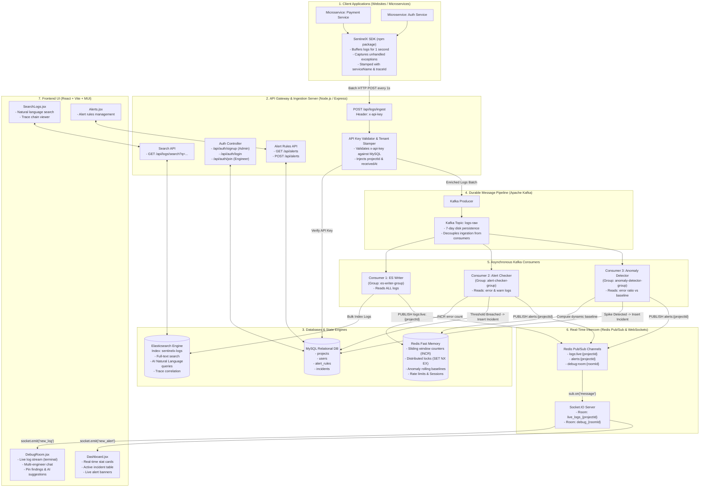
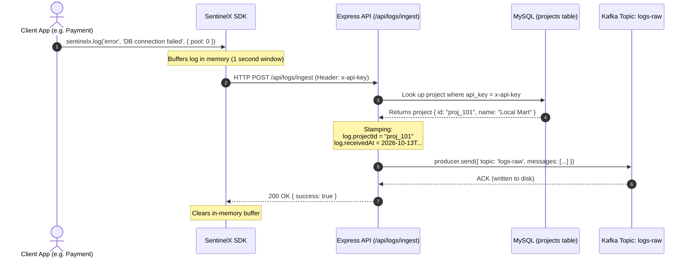
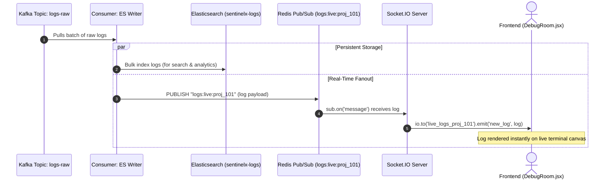
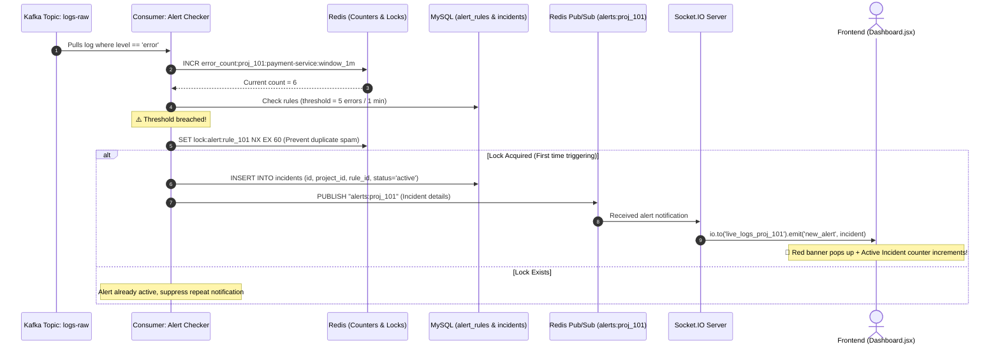
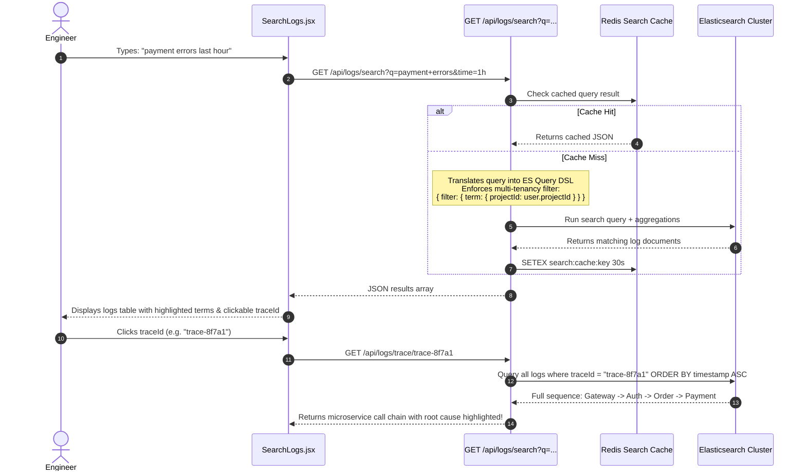

# 🛡️ SentinelX — Complete System Architecture & Pipeline Diagrams

This document contains visual diagrams and detailed workflow mappings for the entire **SentinelX** platform.

---

## 📌 Table of Contents
1. [Master System Architecture](#1-master-system-architecture)
2. [Pipeline 1: Log Ingestion & Multi-Tenant Stamping](#2-pipeline-1-log-ingestion--multi-tenant-stamping)
3. [Pipeline 2: Live Log Streaming](#3-pipeline-2-live-log-streaming)
4. [Pipeline 3: Alert & Incident Detection](#4-pipeline-3-alert--incident-detection)
5. [Pipeline 4: Search & Trace Correlation](#5-pipeline-4-search--trace-correlation)
6. [Technology Responsibility Matrix](#6-technology-responsibility-matrix)
7. [Codebase File Mapping](#7-codebase-file-mapping)

---

## 1. Master System Architecture

This flowchart illustrates the end-to-end data flow from client microservices to storage, processing, real-time push, and frontend dashboards:



---

## 2. Pipeline 1: Log Ingestion & Multi-Tenant Stamping

How an application log is produced, buffered, authenticated, and delivered safely to Kafka:



---

## 3. Pipeline 2: Live Log Streaming

How logs flow in real time from Kafka to Elasticsearch and the browser's debug screen:



---

## 4. Pipeline 3: Alert & Incident Detection

How error spikes are caught, counted, stored as incidents, and pushed as alerts:



---

## 5. Pipeline 4: Search & Trace Correlation

How natural language search and distributed trace inspection work:



---

## 6. Technology Responsibility Matrix

| Technology | Primary Role in SentinelX | Why It Was Chosen |
| :--- | :--- | :--- |
| **SentinelX SDK** | Log Capture & Buffering | Buffers logs for 1 second to avoid spamming HTTP requests; captures uncaught exceptions automatically. |
| **Node.js / Express** | API Gateway & Ingestion | Event-driven, low latency, handles high-throughput log ingestion and serves REST endpoints. |
| **Apache Kafka** | Shock Absorber & Queue | Stores logs on disk for 7 days; fan-outs the exact same log stream to 3 independent consumer groups. |
| **Elasticsearch** | Search & Analytics Engine | Fast full-text search, fuzzy matching, date histogram aggregations, trace correlation. |
| **MySQL** | Relational Business Data | ACID compliance for Projects, Users, Alert Rules, and Incident records. |
| **Redis** | High-Speed Cache & Intercom | Fast atomic counters (`INCR`), sliding-window rate limiting, distributed locks (`SET NX EX`), and Pub/Sub backend notifications. |
| **Socket.IO** | Server-to-Browser Push | Delivers real-time logs, emergency alerts, and debug room chat directly to the React frontend. |
| **React + MUI** | Engineer Operations UI | Dark-mode interface for monitoring live streams, managing alert rules, searching logs, and collaborating in debug rooms. |

---

## 7. Codebase File Mapping

```
SentinelX/
├── ARCHITECTURE.md                  # <-- You are here (System Architecture & Diagrams)
├── architecture_diagram.html        # <-- Double-clickable interactive HTML visualizer
├── Backend/
│   ├── app.js                       # Express setup, Socket.io, background service init
│   ├── src/
│   │   ├── config/
│   │   │   └── db.js                # MySQL pool connection
│   │   ├── controllers/
│   │   │   └── auth.js              # SignupProjectAdministrator, LoginUser, JoinProject
│   │   ├── kafka/
│   │   │   ├── config.js            # Kafka client setup (brokers)
│   │   │   ├── producer.js          # sendLogToKafka (logs-raw)
│   │   │   └── consumer.js          # Kafka consumer (live stream)
│   │   └── routes/
│   │       ├── auth.js              # Authentication endpoints
│   │       └── logs.js              # /api/logs/ingest
├── Frontend/
│   ├── src/
│   │   ├── pages/
│   │   │   ├── Dashboard.jsx        # Stats & active incidents
│   │   │   ├── SearchLogs.jsx       # Log query & trace viewing
│   │   │   ├── Alerts.jsx           # Alert rule management
│   │   │   ├── DebugRoom.jsx        # Real-time log stream & team chat
│   │   │   └── Login.jsx            # Sign in / Admin signup / Engineer join
│   │   └── context/
│   │       └── AuthContext.jsx      # User session management
└── SentinelX-sdk/
    └── index.js                     # Client SDK (sentinelx.init & sentinelx.log)
```
